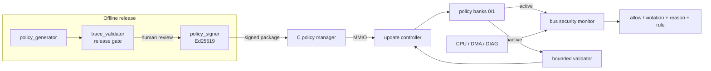
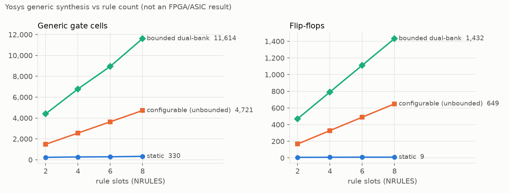

# Field-Upgradeable Hardware Security Monitor

**Design and simulation of a scope-bounded, field-upgradeable hardware security monitor with
trace-validated runtime policy updates for embedded SoCs.**

A bus-transaction security monitor whose rules can be updated after deployment, without changing
its RTL, while **an authorised updater can never exceed the authority assigned to it**. Everything
runs in simulation on a laptop: SystemVerilog RTL (Icarus Verilog, Yosys), portable embedded C
firmware, and small Python tools. No FPGA, board or silicon is involved, and no such result is claimed.

## The problem

SoCs stay deployed for years, and new weaknesses appear in that time. A monitor with
rules frozen at manufacture cannot respond. Making the rules updatable opens a second hole: the
component that may update rules can also widen its own access or weaken rules that protect
*other* components. Controlling **who** may write the rules does not limit **what** they may
write. This is the point made by the bounded-delegation preprint this project builds on (see
[docs/RESEARCH_AND_DESIGN.md](docs/RESEARCH_AND_DESIGN.md)).

## What this project contributes

A lightweight, measured combination of three known ideas. Novelty is claimed only for this
combination and its evaluation, not for bounded delegation, hardware monitors or dynamic policies.

| | Contribution | Where |
|---|---|---|
| **A** | **Scope-bounded policy authority** in hardware. Each owner (CPU, DMA, diagnostics) has an immutable envelope: address window, permissions, burst limit and privilege floor. The validator rejects any candidate that escapes its envelope, overlaps another rule, or touches another owner's rules | `rtl/policy_validator.sv` |
| **B** | **Trace-validated policy release.** Before signing, a candidate is replayed against benign and malicious traces. It is refused if it breaks legitimate traffic, re-opens an attack, or changes rules that no trace exercises, with each decision explained by rule | `tools/trace_validator.py` |
| **C** | **Safe atomic switching.** Dual policy banks: the candidate is validated in the inactive bank while the active one keeps enforcing. One select bit flips at a transaction-idle boundary, the previous bank is kept for revert until confirm, and the persistent A/B store survives power loss | `rtl/policy_bank.sv`, `rtl/policy_update_controller.sv`, `firmware/` |

## Architecture



- **Monitor**: checks master ID, address, read/write, privilege, burst length and burst span
  (including wrap-around) against the active bank. Lowest-slot priority, default deny,
  1-cycle registered decision, one transaction per cycle.
- **Policy banks**: 2 × 8 rules of 80 bits. Writes can only reach the inactive bank; there is no
  write path to the active one.
- **Validator**: requester latched at `BEGIN`. It checks version, ownership slot by slot, owner ID,
  range, address, permission, privilege-floor and burst containment, overlaps and rule count,
  in N(N+1)/2 + 3 cycles (39 for 8 rules).
- **Controller**: IDLE → RECEIVE → VALIDATE → READY → WAIT_IDLE → SWITCH → COMPLETE, with
  ROLLBACK, ERROR, revert and confirm. The boot window allows the committed image to be restored
  after reset, still envelope-checked.
- **Firmware** (C99, no OS): parses packages length-first, verifies Ed25519 with keys from device
  configuration (Monocypher 4.0.2), enforces the device ID, the anti-rollback version chain and
  the A/B persistent store, and restores on boot. A one-way counter (a model of OTP/RPMB)
  stops the store from being pointed back at an older signed image. Two HAL backends: memory-mapped hardware, and
  a native host model used for tests.

Details: [design](docs/RESEARCH_AND_DESIGN.md) · [threat model](docs/THREAT_MODEL.md) ·
[experiment method](docs/EXPERIMENTS.md) · [measured results](RESULTS.md)

## Security scenarios (synthetic)

All three run on the **same RTL**: only the authenticated policy changes. These are controlled
examples, not reproductions of real CVEs.

| Policy | Requester | Change | Attacks still accepted on the trace |
|---|---|---|---|
| v1 | provisioning (factory) | baseline with three weaknesses | 104 / 159 |
| v2 | DMA | scenario 1: remove 0x1000_8000–0x1000_8FFF from DMA's window | 62 |
| v3 | CPU | scenario 2: peripheral page 0xF000–0xFFFF privileged-only | 31 |
| v4 | DMA | scenario 3: max DMA burst 64 → 16 beats | **0** (legitimate rejected: 0) |

Eight authorised-but-malicious updates are rejected by the hardware, each with its own error
code: widening DMA past its envelope, raising its burst, diagnostics granting itself write,
dropping its privilege floor, editing, deleting or impersonating another owner's rules, and a
shadow overlap rule. Two candidates that **are** within authority (one over-restrictive, one
re-opening scenario 1) are refused by the offline trace gate instead.

## Headline results (measured; full tables in [RESULTS.md](RESULTS.md))

| | Static | Configurable, unbounded | **Bounded dual-bank** |
|---|---:|---:|---:|
| Can be fixed after deployment | no | yes | yes |
| Attacks accepted after the v4 fix (of 159) | 104 (stuck at v1) | 0 | 0 |
| 8 malicious authorised updates that took effect | n/a | 8 | **0** |
| Attacks accepted after those updates (total over 8) | n/a | 99 | **0** |
| Inconsistent decisions while updating under traffic (60 runs) | n/a | 34 | **0** |
| Generic cells / flip-flops, 8 rules (Yosys, not FPGA/ASIC) | 330 / 9 | 4 721 / 649 | 11 614 / 1 432 |
| Decision latency | 1 cycle | 1 cycle | 1 cycle |

The price of bounded, atomic updates is about 2.5× the generic cells of the unbounded
configurable monitor (a second bank plus the validator), 39 validation cycles, and about 15
cycles of held traffic per switch on a busy bus.




## Build and run

Requirements: Python ≥ 3.10, GCC, GNU Make, Icarus Verilog ≥ 12, and Yosys (installed from
`requirements.txt` as `yowasp-yosys`). Run from the repository root in a POSIX shell (Git Bash or
MSYS2 on Windows). If the tools are not on `PATH`, copy `local.mk.example` to `local.mk`.

```bash
make test
```
Python tests, C firmware tests, all RTL testbenches, and the mutation check.

```bash
make test-c
```
Firmware: crypto interoperability, package fuzzing, owner-bounded installs, fault injection.

```bash
make sim-rtl
```
RTL regression plus replay of the firmware's register traffic into the RTL.

```bash
make synth
```
Yosys generic synthesis of the 3 designs × 2/4/6/8 rules → `results/synth.csv`.

```bash
make demo
```
Release gate → firmware workflow (with a power loss) → same traffic replayed on the RTL.

```bash
make experiments
```
All comparative experiments and plots → `results/`.

```bash
make clean
```

The first run creates `.venv` and test keys under `build/keys/` (git-ignored). Packages are
signed with those local keys, so no private key is ever committed.

## Repository layout

```text
rtl/        monitor, policy banks, validator, update controller, top (3 modes), shared defs
tb/         self-checking testbenches: datapath + trace replay, update flow, firmware MMIO replay
firmware/   include/ src/ tests/ third_party/monocypher (C99 policy manager, host model, demo)
tools/      policy_generator.py, policy_signer.py, trace_validator.py, hsm_common.py
examples/   policy_v1..v4.json, attacks/*.json, candidates/*.json
scripts/    run_rtl.py, mutation_check.py, synth.py, run_experiments.py
tests/      pytest suites (tools, cross-language constant checks)
docs/       RESEARCH_AND_DESIGN.md, THREAT_MODEL.md, EXPERIMENTS.md
results/    measured CSV/JSON and plots (regenerated by make experiments)
```

## Verification

- Python reference models of the monitor and the validator. The RTL must match them on every
  one of 477 transactions under each policy and design.
- The C test suite (1 239 checks) runs against a register-level host model. Its 17 852 recorded
  register operations, including 431 resets from power-loss tests, are replayed into the RTL and
  every read-back is compared. The suite is clean under UBSan; CI adds ASan (not yet run on GitHub).
- Directed RTL tests: datapath, authority (including one address outside each envelope bound),
  ownership, structure, version, TOCTOU, switching during traffic, a registered interconnect that
  learns of a grant one cycle late, abort, revert, and reset in every update state.
- Mutation check: 21 planted security bugs (for example "validator skips ownership check" or "no
  transaction hold during switch"), and the regression must catch all 21. It does, and every mutant
  is required to compile. Its first run found a missing test (overlap in the last slot pair), since added.
- The Python, C and RTL models share one author and one specification, so agreement between them
  is not fully independent evidence. The directed tests use hand-written expectations.
- Not done: formal verification, gate-level simulation, timing analysis.

## Connection to M.Tech (VLSI & Embedded Systems) subjects

| Subject | Where it shows up |
|---|---|
| Digital VLSI design | Multi-cycle validator FSM, comparators, priority encoder, dual register banks, reset strategy (only valid bits reset) |
| Computer architecture | Bus transactions, bursts, memory protection, DMA isolation, safe switching boundary |
| Embedded systems | Portable C99, HAL with MMIO and host backends, register map, persistent store, no OS |
| Hardware security | Ownership-bounded authority, Ed25519 authenticated updates, anti-rollback, threat model |
| FPGA and reconfigurable computing | Runtime-programmable configuration of fixed hardware (concept only; no FPGA used) |
| Hardware verification | Self-checking testbenches, reference-model equivalence, fault injection, mutation testing |
| VLSI evaluation | Yosys generic synthesis, area scaling, design-space comparison, mux-style iteration |

## Limitations and future work

- Simulation only: no FPGA, eFPGA, partial reconfiguration or silicon. Synthesis numbers are generic.
- The policy manager is trusted to verify signatures and name the requester; hardware does no crypto.
- The anti-rollback counter and the bus_idle interface are modelled. A real SoC must provide
  OTP/RPMB storage and an interconnect that drops bus_idle within one cycle of a grant.
- The GitHub Actions workflow has not been run (nothing has been pushed); Ubuntu's Icarus Verilog
  12 may differ from the 13.0 used here.
- One level of ownership, fixed envelopes, 8 rules, 3 owners. No nested delegation or ownership transfer.
- An owner can still weaken its *own* protection within its envelope. Only the offline gate and
  human review stand against that.
- The firmware does not execute on the RTL: their agreement is shown by MMIO-trace replay, not co-simulation.
- Future: a RISC-V core driving the monitor (e.g. Verilator or Renode co-simulation), formal
  proofs of the validator's containment properties, technology-mapped synthesis with timing, and
  key rotation.

## References

1. L. Cunha et al., "Reconfiguring System-Level Protection Through Bounded Delegation in RISC-V
   MCUs," arXiv:2611.12622, Nov. 2026 (preprint, not peer reviewed).
2. "Language Semantics to Support Secure Computation and Communication in Embedded Systems via
   Hardware Monitors" (D-GUARD), Integration, the VLSI Journal, 2025, doi:10.1016/j.vlsi.2025.102367.
3. "The Road Not Taken: eFPGA Accelerators Utilized for SoC Security Auditing" (EnSAFe), IEEE
   TCAD, 2024, doi:10.1109/TCAD.2024.3387350.
4. A. Regenscheid, NIST SP 800-193, "Platform Firmware Resiliency Guidelines," 2018.
5. Monocypher 4.0.2, L. Vaillant, https://monocypher.org (vendored, CC0 / BSD-2-Clause).
