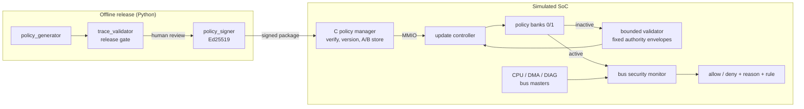
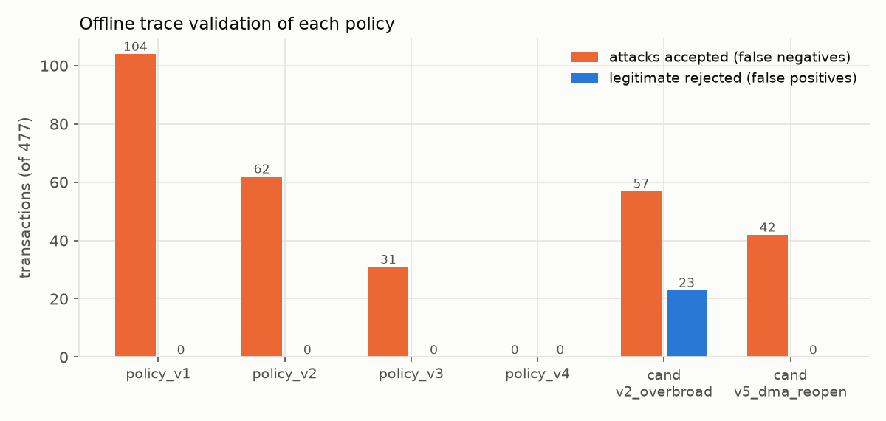

# Field-Upgradeable Hardware Security Monitor

[](https://github.com/Sayoojpv2/field-upgradable-hardware-security-monitor/actions/workflows/ci.yml)

**Design and simulation of a scope-bounded, field-upgradeable hardware security monitor with
trace-validated runtime policy updates for embedded SoCs.**

This is a bus-transaction security monitor whose rules can be updated after deployment without
changing its RTL. An authorised updater can never give itself more authority than it was assigned.

The project is SystemVerilog RTL (Icarus Verilog and Yosys), portable C99 firmware and small
Python tools, and it all runs in simulation on a laptop. No FPGA, board or silicon is involved,
and no hardware measurement is claimed.

## The problem

Embedded SoCs stay in the field for years, and new weaknesses are found after they ship. Typical
examples are a DMA engine that can reach memory it should not, an unprivileged path to a
peripheral, or an oversized burst. A bus monitor whose rules are frozen at manufacture cannot be
fixed.

Making the rules updatable creates a second problem. Whoever may update the rules can also widen
their own access, or weaken rules that protect *other* components. Controlling **who** may write
the rules does not limit **what** they may write.

## Research motivation

| Source | Status | How it is used |
|---|---|---|
| L. Cunha et al., *Reconfiguring System-Level Protection Through Bounded Delegation in RISC-V MCUs*, arXiv:2611.12622, 2026 | **Preprint**, not peer reviewed. Abstract and about 40% of the full text read | Main inspiration: an updater should be limited by *ownership* and *containment*, not only by authentication |
| D-GUARD: *Language Semantics to Support Secure Computation and Communication in Embedded Systems via Hardware Monitors*, Integration, the VLSI Journal, 2025, doi:10.1016/j.vlsi.2025.102367 | Peer reviewed. **Full text not accessible** here | Motivation only (programmable hardware monitors); no technical claim depends on it |
| EnSAFe: *The Road Not Taken: eFPGA Accelerators Utilized for SoC Security Auditing*, IEEE TCAD, 2024, doi:10.1109/TCAD.2024.3387350 | Peer reviewed. **Full text not accessible** here | Motivation only (reconfigurable security auditing); no technical claim depends on it |
| A. Regenscheid, NIST SP 800-193, *Platform Firmware Resiliency Guidelines*, 2018 | NIST standard. Full text read | Authenticated updates, anti-rollback, recovery, applied to *policy* data instead of firmware |
| C. Nokes, K. Amberiadis, D. R. Kuhn, E. Reed, M. Zuzak, *Verifying Hardware Resource Isolation through Mandatory Access Control Policy*, ISQED 2026, doi:10.1109/ISQED69900.2026.11534784 | Peer-reviewed conference paper (NIST). Abstract and NIST PDF read | Method for the formal properties: master = subject, address range = object, access mode = permissions + privilege + burst |

What each source contributes, and what was and was not read, is set out in
[docs/RESEARCH_AND_DESIGN.md](docs/RESEARCH_AND_DESIGN.md).

## Contribution

The building blocks are known: bounded delegation, hardware monitors, dynamic policies and A/B
updates. This project claims only their **combination** for a transaction-level bus monitor and
its measured and verified evaluation, not any one of them.

| | Contribution | Where |
|---|---|---|
| **A** | **Scope-bounded policy updates.** Each owner (CPU, DMA, diagnostics) has an immutable *authority envelope*: address window, permissions, burst limit and privilege floor. An owner may only change its own rules, and only inside its envelope | `rtl/hsm_defs.svh`, `rtl/policy_validator.sv` |
| **B** | **Hardware policy validation.** Every candidate is checked in hardware, rule by rule, before it can take effect: ownership slot by slot, envelope containment, no overlaps, rule count and version. Each rejection gets its own error code | `rtl/policy_validator.sv` |
| **C** | **Trace-based candidate evaluation.** Before signing, a candidate is replayed against benign and malicious traces. It is refused if it breaks legitimate traffic, re-opens an attack, or changes rules that no trace exercises, with each decision explained by rule | `tools/trace_validator.py` |
| **D** | **Atomic dual-bank activation.** The candidate is written and validated in the inactive bank while the active one keeps enforcing. A single select bit flips at a transaction-idle boundary, and the previous bank is kept for revert until confirm | `rtl/policy_bank.sv`, `rtl/policy_update_controller.sv` |
| **E** | **Authenticated, rollback-proof, power-safe updates.** Ed25519-signed packages, a version chain, a one-way anti-rollback counter, and an A/B persistent store that recovers from power loss at every tested point (7 update stages, and a torn write at every byte of the store writes) | `firmware/` |
| **F** | **Formal verification of the hardware properties** (A, B, D). Unbounded proofs at module level, a bounded end-to-end check, and an independent reference model. The firmware (E) is tested, not formally verified | `formal/`, `tests/independent_model.py` |

## Architecture



**Hardware (SystemVerilog, `rtl/`).**

- **Monitor**: checks the master ID, address, read/write, privilege, burst length and burst span
  (including wrap-around) against the active bank. Lowest slot wins, everything else is denied,
  and the decision is registered in one cycle, one transaction per cycle.
- **Policy banks**: 2 × 8 rules of 80 bits. Writes can only reach the inactive bank; there is no
  write path to the active one.
- **Validator**: latches the requester at `BEGIN` and checks the whole candidate in
  N(N+1)/2 + 3 cycles (39 for 8 rules).
- **Update controller**: IDLE → RECEIVE → VALIDATE → READY → WAIT_IDLE → SWITCH → COMPLETE, with
  ROLLBACK, ERROR, revert and confirm. New transactions are held only while it waits for the idle
  boundary and switches. A boot window lets the committed image be restored after reset, still
  envelope-checked.
- **Top level**: three modes for comparison. Static rules (0), an unbounded configurable monitor
  (1), and this design (2).

**Software.**

- **C policy manager** (C99, no OS, `firmware/`):
  - parses packages length-first;
  - verifies Ed25519 with public keys from device configuration (Monocypher 4.0.2), never from
    the package;
  - enforces the device ID, the version chain and the anti-rollback counter;
  - keeps an A/B persistent store and restores the committed policy at boot.

  It has two HAL backends: memory-mapped hardware, and a register-level host model used for tests.
- **Python tools** (`tools/`): policy generator, package signer, trace generator and release gate.

The hardware does **not** verify signatures. It trusts the policy manager to name the
authenticated requester, and then limits what that requester can install.

## Walkthrough: one command

```bash
make demo
```

`make demo` runs ten steps on the unchanged RTL, and each step checks its own result
(`scripts/demo.py`):

1. Initial policy **v1** (factory) is installed through the boot window.
2. RTL, v1: a legitimate DMA write to 0x1000_0100 is **allowed**.
3. RTL, v1: a DMA write to the protected page 0x1000_8000 is also **allowed**. This is the
   vulnerability (scenario 1).
4. The DMA owner's fix, **v2**, is generated by `policy_generator`.
5. The release gate evaluates it on the 477-transaction corpus. It **recommends** v2, v3 and v4,
   and **refuses** an over-broad and a re-opening candidate.
6. A DMA-signed update that widens DMA's window past its envelope is **rejected by the hardware
   validator** (`ADDR_ESCAPE`). v1 stays in force.
7. v2 is staged in the inactive bank with requester DMA and **accepted** by the validator.
8. It is **activated**: the bank switches at an idle boundary and v2 is confirmed.
9. RTL, v2: the same DMA write to 0x1000_8000 is now **denied** (`NO_RULE`); the legitimate write
   is still allowed.
10. Device run: the C policy manager installs v2 → v3 → v4, power is cut after v4 is activated
    and before it is committed, and the reboot **recovers the committed v3**. Twelve malicious,
    forged and replayed packages are rejected. The same register traffic is replayed into the RTL
    with identical read-backs.

## Results

All values come from runs of this repository. Full tables and method:
[RESULTS.md](RESULTS.md), [docs/EXPERIMENTS.md](docs/EXPERIMENTS.md).

**Security: the three designs on the same 477-transaction corpus (159 attacks).**

| | Static | Configurable, unbounded | **Bounded dual-bank** |
|---|---:|---:|---:|
| Can be fixed after deployment | no | yes | yes |
| Attacks accepted after the v4 fix (of 159) | 104 (stuck at v1) | 0 | 0 |
| 8 malicious authorised updates that took effect | n/a | 8 | **0** |
| Attacks accepted after those updates (total over 8) | n/a | 99 | **0** |
| Inconsistent decisions while updating under traffic (60 runs) | n/a | 34 | **0** |
| Decision latency | 1 cycle | 1 cycle | 1 cycle |

**Verification.**

| Evidence | Result |
|---|---|
| Formal, unbounded (Yosys SAT, k-induction / one-step) | 10/10 jobs **PROVED**: properties A–F at module level, top level with 8 slots |
| Formal, second engine (SymbiYosys, smtbmc + yices, CI) | The same 10 proof jobs PASS; 2/2 planted bugs FAIL |
| Formal, bounded | End-to-end property: **BOUNDED PASS to 40 cycles** (2 slots). Not a proof |
| Formal non-vacuity | 13/13 covers reached; 10/10 planted bugs produce a counterexample |
| Independent reference model (no shared code) | 10 987 RTL comparisons, 0 mismatches |
| RTL simulation (Icarus Verilog) | 25/25 testbench runs, 31 829 checks |
| C firmware | 1 239 checks, also clean under ASan + UBSan on CI; 3 000-mutation package fuzz and every truncation length rejected |
| Firmware → RTL register replay | 17 852 operations, identical read-backs |
| Simulation mutation testing | 22/22 planted security bugs caught |
| Recovery | 7/7 interruption points restore the committed policy; 205/205 torn-write runs recover |
| Python | 34 tests |
| GitHub Actions, every push (Ubuntu 24.04, GCC 13.3, Icarus 12.0) | C under ASan + UBSan, Python, C, RTL, mutation check, synthesis, demo, `make formal` and SymbiYosys all pass |

**Cost: Yosys generic synthesis, 8 rules.** These are technology-independent counts, not FPGA or
ASIC area.

| | Static | Configurable, unbounded | Bounded dual-bank |
|---|---:|---:|---:|
| Generic cells | 315 | 4 721 | 11 603 |
| Flip-flops | 9 | 649 | 1 432 |

Bounded, atomic updates cost about 2.5× the generic cells of the unbounded monitor (a second bank
plus the validator), 39 validation cycles, and about 15 cycles of held traffic per switch on a
busy bus.




## Reproduce from a clean checkout

Requirements: Python ≥ 3.10, GCC, GNU Make, Icarus Verilog ≥ 12 and Git. Yosys is installed into
`.venv` from `requirements.txt` (`yowasp-yosys`, version pinned). The first run creates `.venv` and fresh test
signing keys under `build/keys/`. Both are git-ignored, so no private key is ever committed.

**Ubuntu 24.04** (the CI environment):

```bash
sudo apt-get install -y git gcc make iverilog python3-venv
```

```bash
git clone https://github.com/Sayoojpv2/field-upgradable-hardware-security-monitor.git
```

```bash
cd field-upgradable-hardware-security-monitor && make test
```

**Windows 11 (Git Bash):** install the following.

- Python 3 and Git for Windows.
- GNU Make, for example `winget install ezwinports.make`.
- GCC and Icarus Verilog, for example the MSYS2 UCRT64 packages `mingw-w64-ucrt-x86_64-gcc` and
  `mingw-w64-ucrt-x86_64-iverilog`.

Copy `local.mk.example` to `local.mk` and adjust it. It sets `PYTHON := python` (Windows has no
`python3` by default) and the tool paths for tools that are not on `PATH`. Then clone the
repository as above and run in Git Bash:

```bash
make test
```

| Target | What it runs |
|---|---|
| `make test` | Python tests, C firmware tests, all RTL testbenches, mutation check |
| `make test-c` | Firmware: crypto interoperability, fuzzing, owner-bounded installs, fault injection |
| `make sim-rtl` | RTL regression, independent-model comparison, firmware register replay |
| `make formal` | Proofs, bounded check, covers, planted bugs (Yosys SAT) → `results/formal.*`; 8–30 min (about 8 on CI), most of it the 40-cycle bounded check |
| `make synth` | Yosys synthesis, 3 designs × 2/4/6/8 rules → `results/synth.csv` |
| `make demo` | The ten-step walkthrough above |
| `make experiments` | All comparative experiments and plots → `results/` |
| `make clean` | Removes `build/` |

On a laptop, `make test`, `make demo` and `make experiments` together take a few minutes.

## Repository layout

```text
rtl/        monitor, policy banks, validator, update controller, top (3 modes), shared defs
tb/         self-checking testbenches: datapath + trace replay, update flow, firmware MMIO replay
firmware/   include/ src/ tests/ third_party/monocypher (C99 policy manager, host model, demo)
tools/      policy_generator.py, policy_signer.py, trace_validator.py, hsm_common.py
examples/   policy_v1..v4.json, attacks/*.json, candidates/*.json
formal/     executable spec, property files, harnesses, SymbiYosys config, d426302 counterexample
scripts/    run_rtl.py, run_formal.py, mutation_check.py, synth.py, run_experiments.py, demo.py
tests/      pytest suites, independent reference model (independent_model.py)
docs/       RESEARCH_AND_DESIGN.md, THREAT_MODEL.md, EXPERIMENTS.md
results/    measured CSV/JSON and plots (regenerated by make experiments / make formal)
```

## Limitations

- **Simulation only.** There is no FPGA or ASIC implementation, and no power, timing or silicon
  measurement. Synthesis numbers are generic Yosys cell counts, useful only for comparing the
  three designs.
- **The C firmware is tested, not formally verified.** It has 1 239 checks, fuzzing, fault
  injection and sanitizers.
- **The end-to-end formal check is bounded** (40 cycles, 2 slots). It is backed by unbounded
  module-level proofs and a written assume-guarantee argument ([formal/README.md](formal/README.md)),
  not by an unbounded proof of the composed system. There are no liveness proofs.
- **Trusted components.**
  - The policy manager is trusted to verify signatures and name the requester; the hardware does
    no cryptography.
  - The interconnect must drop `bus_idle` within one cycle of a grant; this is an interface
    contract, not a proved property.
  - The anti-rollback counter models OTP/RPMB storage.
- **No guarantee against unknown vulnerabilities.** The monitor enforces the policy it is given.
  The trace gate judges behaviour only on the traces it has. An owner can still weaken its *own*
  protection inside its envelope; only the gate and human review stand against that.
- **Synthetic scenarios.** The three vulnerabilities are controlled examples, not real CVEs.
- **Fixed scope.** One level of ownership, fixed envelopes, 8 rules and 3 owners.
- **No co-simulation.** The firmware does not execute on the RTL. Their agreement is shown by
  replaying its register traffic.
- **Shared authorship.** The specification, both Python models and the RTL share one author, so
  their agreement is not fully independent evidence.

[docs/THREAT_MODEL.md](docs/THREAT_MODEL.md) lists the attacks that are addressed and those that
are not.

## Connection to M.Tech (VLSI & Embedded Systems) subjects

| Subject | Where it shows up |
|---|---|
| Digital VLSI design | Multi-cycle validator FSM, comparators, priority encoder, dual register banks, reset strategy |
| Computer architecture | Bus transactions, bursts, memory protection, DMA isolation, safe switching boundary |
| Embedded systems | Portable C99, HAL with MMIO and host backends, register map, persistent store, no OS |
| Hardware security | Ownership-bounded authority, Ed25519 authenticated updates, anti-rollback, threat model |
| Hardware verification | Self-checking testbenches, reference models, fault injection, mutation testing, k-induction, BMC, covers |
| VLSI evaluation | Yosys generic synthesis, area scaling, design-space comparison |

## References

1. L. Cunha et al., "Reconfiguring System-Level Protection Through Bounded Delegation in RISC-V
   MCUs," arXiv:2611.12622, Nov. 2026 (preprint, not peer reviewed).
2. "Language Semantics to Support Secure Computation and Communication in Embedded Systems via
   Hardware Monitors" (D-GUARD), Integration, the VLSI Journal, 2025, doi:10.1016/j.vlsi.2025.102367
   (full text not accessed).
3. "The Road Not Taken: eFPGA Accelerators Utilized for SoC Security Auditing" (EnSAFe), IEEE
   TCAD, 2024, doi:10.1109/TCAD.2024.3387350 (full text not accessed).
4. A. Regenscheid, NIST SP 800-193, "Platform Firmware Resiliency Guidelines," 2018.
5. C. Nokes, K. Amberiadis, D. R. Kuhn, E. Reed, M. Zuzak, "Verifying Hardware Resource Isolation
   through Mandatory Access Control Policy," ISQED 2026, doi:10.1109/ISQED69900.2026.11534784.
6. SymbiYosys documentation, https://symbiyosys.readthedocs.io/ (configuration in `formal/hsm.sby`).
7. Monocypher 4.0.2, L. Vaillant, https://monocypher.org (vendored; CC0 / BSD-2-Clause).
