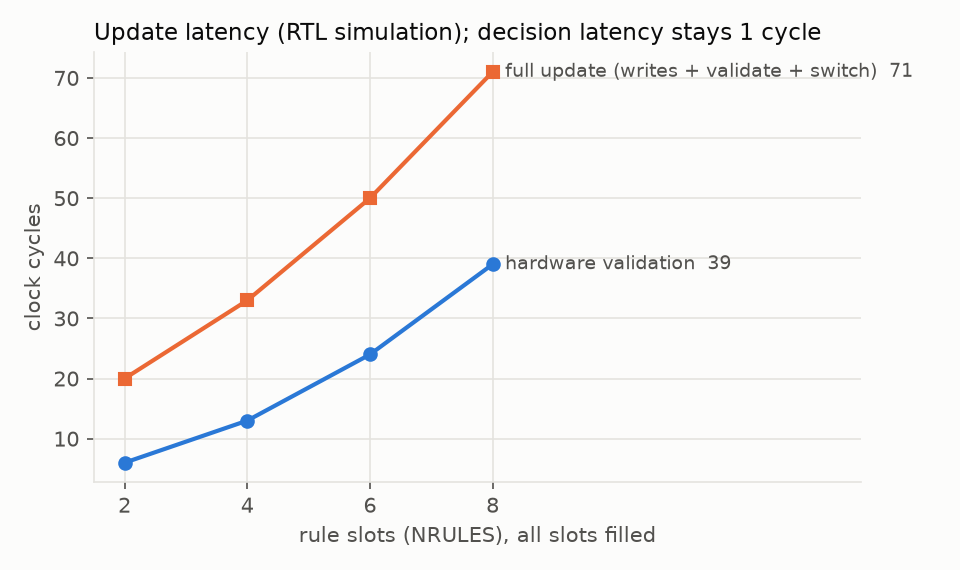
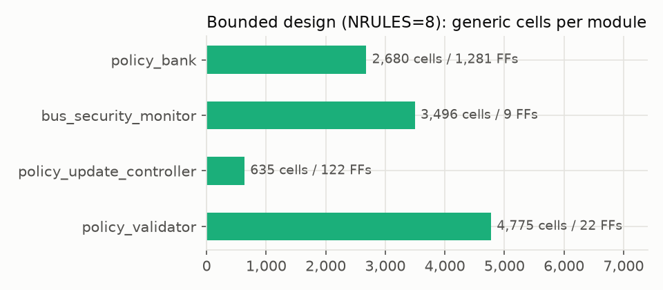

# Results

Every number below comes from a run in this repository: an RTL simulation (Icarus Verilog 13.0; the RTL tests also pass on 12.0, which CI uses),
a Yosys 0.70 run (synthesis or formal), the firmware test binary (GCC 16.2), or the generated
packages. Regenerate them with `make test`, `make experiments` and `make formal`. Data: `results/*.csv`, `results/summary.json`; per-decision
logs are regenerated in `results/raw/` by `make experiments` and are not committed. Method and caveats: [docs/EXPERIMENTS.md](docs/EXPERIMENTS.md).
These are simulation and generic-synthesis results, not FPGA, ASIC or hardware measurements.

## 1. Test results

| Suite | Result |
|---|---|
| Python (`pytest`: tools, cross-language constants, independent model vs production model) | 34 passed |
| C firmware (`test_firmware`) | 1 239 checks, 0 failures |
| C firmware under UBSan (`-fsanitize=undefined -fsanitize-trap=all`, local) | 1 239 checks, no trap |
| C firmware under ASan + UBSan (`-fsanitize=address,undefined`, GitHub Actions, GCC on Ubuntu 24.04) | 1 239 checks, 0 failures, no sanitizer report (MinGW has no ASan runtime, so CI only) |
| RTL regression (`run_rtl.py`) | 25/25 testbench runs, 31 829 checks, 0 errors |
| RTL vs independent reference model (`tests/independent_model.py`) | 10 987 comparisons, 0 mismatches (see section 9) |
| Firmware → RTL MMIO replay (C test suite) | 17 852 operations, 2 993 read-backs identical, 431 resets |
| Firmware → RTL MMIO replay (demo) | 381 operations, identical |
| Mutation check, simulation (planted RTL security bugs, every mutant must compile) | 22/22 caught |
| Formal verification (`make formal`, Yosys SAT) | 10 jobs PROVED, 1 BOUNDED PASS (depth 40), 13/13 covers reached, 10/10 planted bugs give a counterexample (section 10) |
| SymbiYosys (`formal/hsm.sby`, smtbmc + yices, GitHub Actions job `formal-sby`) | 10/10 tasks PASS (k-induction); 2/2 planted bugs give FAIL |
| Package fuzzing (3 000 random corruptions of a signed package) | 0 accepted |
| Truncation (every length shorter than a valid package) | all rejected as `TRUNCATED` |
| Yosys `check -assert`, latch scan | clean, 0 latches in all 24 configurations |
| GitHub Actions (Ubuntu 24.04: GCC 13.3, Icarus Verilog 12.0, Python 3.12) | every job passes: ASan + UBSan C tests, `make test`, `make synth`, `make demo`, `make formal`, SymbiYosys with planted-bug check |

## 2. The three scenarios on unchanged RTL

Same 477-transaction trace (318 benign, 159 malicious); the RTL decisions match the Python
reference model exactly for every policy.

| Policy | Attacks accepted | Legitimate rejected | FN rate | FP rate | Release gate |
|---|---:|---:|---:|---:|---|
| v1 factory | 104 | 0 | 0.654 | 0 | – |
| v2 (DMA, scenario 1) | 62 | 0 | 0.390 | 0 | recommended |
| v3 (CPU, scenario 2) | 31 | 0 | 0.195 | 0 | recommended |
| v4 (DMA, scenario 3) | **0** | **0** | 0 | 0 | recommended |
| cand_v2_overbroad (within authority) | 57 | **23** | 0.359 | 0.072 | **NOT recommended**: 23 legitimate transactions newly rejected |
| cand_v5_dma_reopen (within authority) | **42** | 0 | 0.264 | 0 | **NOT recommended**: 42 attacks newly accepted |

The two flawed candidates pass the hardware authority check, as they should: they stay inside
DMA's envelope. Only the offline trace gate catches them, which is why contributions A and B
are complementary.

## 3. Design comparison on identical traces

| Design | Policy | Benign accepted | Benign rejected | Malicious accepted | Malicious rejected |
|---|---|---:|---:|---:|---:|
| Static | v1, fixed at synthesis | 318 | 0 | 104 | 55 |
| Configurable (unbounded) | v4 | 318 | 0 | 0 | 159 |
| Bounded dual-bank | v4 | 318 | 0 | 0 | 159 |

The static monitor cannot receive the fixes: its 104 false negatives remain until the silicon is changed.

### Authorised but malicious updates (8 attack images applied on top of v4)

| Design | Updates that took effect | Attacks accepted afterwards (sum) | Legitimate rejected afterwards (sum) |
|---|---:|---:|---:|
| Configurable (unbounded) | 8 / 8 | 99 | 31 |
| Bounded dual-bank | **0 / 8** | **0** | **0** |

| Attack image (signed by a real owner key) | Unbounded: attacks / legit broken | Bounded: hardware error |
|---|---|---|
| atk_dma_expand: DMA widens past 0x1000FFFF | 1 / 0 | ADDR_ESCAPE (slot 3) |
| atk_dma_burst: DMA burst 128 > 64 | 16 / 0 | BURST_ESC (slot 1) |
| atk_diag_write: diagnostics grants itself write | 10 / 0 | PERM_ESC (slot 2) |
| atk_diag_unpriv: diagnostics drops privilege | 10 / 0 | PRIV_FLOOR (slot 2) |
| atk_dma_foreign_modify: DMA re-opens CPU peripheral | 31 / 0 | FOREIGN (slot 0) |
| atk_dma_foreign_delete: DMA deletes CPU rule | 0 / 31 | FOREIGN (slot 4) |
| atk_dma_claim_slot: DMA writes a DIAG rule | 0 / 0 | FOREIGN (slot 5) |
| atk_dma_overlap: DMA shadow rule | 31 / 0 | OVERLAP (slot 5) |

### Updating while one transaction is issued every cycle (20 runs per transition)

| Design | Transition | Decisions | Inconsistent decisions | Update window (cycles) | Held cycles per update |
|---|---|---:|---:|---:|---:|
| Configurable (unbounded) | v1→v2 | 1 500 | 18 | 16.0 | 0 |
| Configurable (unbounded) | v2→v3 | 1 540 | 14 | 18.0 | 0 |
| Configurable (unbounded) | v3→v4 | 1 540 | 2 | 18.0 | 0 |
| Bounded dual-bank | v1→v2 | 2 340 | **0** | 74.2 | 16.2 |
| Bounded dual-bank | v2→v3 | 2 400 | **0** | 75.9 | 14.9 |
| Bounded dual-bank | v3→v4 | 2 400 | **0** | 75.9 | 14.9 |

The unbounded monitor exposes half-written policies. During v1→v2, 15 legitimate DMA buffer
accesses (plus 3 oversized bursts that both policies allow) were denied while slot 1 was already
shrunk and slot 3 not yet written. During v2→v3, 14 legitimate privileged peripheral accesses
were denied while the CPU rule was shrunk but its privileged replacement was not written yet.
During v3→v4 there were 2 decisions where the old burst limit reappeared after the new one had
taken effect. The bounded design never shows an intermediate state. Its cost
is a longer update (validation included) and about 15 cycles in which new transactions are held
while outstanding bursts drain. Under traffic, every run cut over exactly once.

## 4. Latency and update overhead (bounded design, all slots filled)

| Rule slots | Validation cycles | Full update cycles¹ | MMIO writes | Switch hold (idle bus) | Decision latency | Package bytes |
|---:|---:|---:|---:|---:|---:|---:|
| 2 | 6 | 20 | 12 | 2 | 1 | 144 |
| 4 | 13 | 33 | 18 | 2 | 1 | 168 |
| 6 | 24 | 50 | 24 | 2 | 1 | 192 |
| 8 | 39 | 71 | 30 | 2 | 1 | 216 |

¹ From the first configuration write to `COMPLETE`, one register write per cycle, idle bus.
Validation follows N(N+1)/2 + 3 exactly. The transaction decision path is not lengthened by the
update logic: 1 cycle in all three designs.

## 5. Synthesis (Yosys generic, technology-independent)

| Design | Rules | Gate cells | Flip-flops | Generic LUT6 |
|---|---:|---:|---:|---:|
| Static | 2 / 4 / 6 / 8 | 228 / 273 / 284 / 315 | 7 / 8 / 9 / 9 | 35 / 48 / 54 / 61 |
| Configurable (unbounded) | 2 / 4 / 6 / 8 | 1 485 / 2 559 / 3 641 / 4 721 | 167 / 328 / 489 / 649 | 303 / 470 / 681 / 831 |
| Bounded dual-bank | 2 / 4 / 6 / 8 | 4 420 / 6 811 / 8 968 / 11 603 | 470 / 791 / 1 112 / 1 432 | 1 213 / 2 089 / 2 775 / 3 496 |

Per module, bounded design, 8 rules (hierarchy kept):

| Module | Gate cells | Flip-flops |
|---|---:|---:|
| policy_bank | 2 680 | 1 281 |
| bus_security_monitor | 3 496 | 9 |
| policy_update_controller | 635 | 122 |
| policy_validator | 4 775 | 22 |
| security_monitor_top (grant-cycle bus_idle gate) | 2 | 0 |

At 8 rules the bounded design costs 2.5× the cells and 2.2× the flip-flops of the unbounded
configurable monitor. The second bank (640 FFs) and the validator's three 80-bit read ports
dominate. The static monitor is tiny because the policy constant-folds into the logic, which is
also why it cannot be updated. These are generic counts with no technology library, timing or
power, so they are not comparable with the FPGA LUT figures in the referenced preprint.

## 6. Recovery (firmware + host hardware model)

| Power loss at | Restored version | Correct | Update retry afterwards |
|---|---:|---|---|
| candidate package stored | 2 (committed) | yes | succeeds |
| half the rules loaded | 2 | yes | succeeds |
| during hardware validation | 2 | yes | succeeds |
| candidate validated (READY) | 2 | yes | succeeds |
| switch requested | 2 | yes | succeeds |
| switched, not yet committed | 2 | yes | succeeds |
| committed, not yet confirmed | 3 (new) | yes | – |

- **Torn-write sweep**: a power loss after every possible number of programmed bytes during an
  update gave 205/205 boots restoring exactly the committed policy.
- **Store write failure after the switch**: the hardware reverted to the retained previous bank
  (version 4 active again).
- **Corrupted committed image**: rejected at boot (`DIGEST`). The monitor stays default-deny with
  the boot window locked.
- **Reset in each update state** (RECEIVE, VALIDATE, READY, WAIT_IDLE, SWITCH, COMPLETE), RTL: no
  partial rule ever active, and the committed image restored afterwards.
- **Storage rollback** (metadata rewritten with a valid CRC to point at the older, still signed v2):
  refused at boot by the anti-rollback counter; the monitor stays default-deny. Without the counter,
  the same test restores v2.
- **Activation timeout** (bus never idle): the firmware aborts, the controller leaves WAIT_IDLE so
  traffic flows again, the old policy stays active, and a retry succeeds.
- **Registered interconnect** (bus_idle lags a grant by one cycle), RTL: the bank never flips while
  the burst granted in the ACTIVATE cycle is still transferring. Before the audit fix it did.

## 7. Design iteration

| Change | Before | After |
|---|---:|---:|
| Validator read ports: one-hot AND-OR → indexed part-select | 5 682 cells | 4 860 cells (−14%) |
| Monitor: priority mux → priority-encoded index + indexed select | 3 900 cells | 3 502 cells (−10%) |

Module-level synthesis in isolation; both versions pass the full regression and mutation check.

## 9. Independent reference model

`tests/independent_model.py` re-implements the monitor decision and the bounded-authority check
from the design document, with its own constants and no import from `tools/`. Its vectors are adversarial:

- every owner ID 0–15 and rules in all 8 slots;
- addresses on and one past every envelope bound;
- bursts 0, 1, max, max+1 and 255;
- overlapping, duplicate and inverted rules, a rule reaching `0xFFFFFFFF`, and invalid owners;
- declared counts 0–15, reserved ATTR bits, and requesters 0–15 including ROOT outside the boot window.

| Comparison | Vectors | Mismatches |
|---|---:|---:|
| Monitor decisions, 12 adversarial policies, unbounded design (any rule can be written) | 7 932 | 0 |
| Monitor decisions, valid base policy, bounded design | 636 | 0 |
| Validator outcome (error code and slot) after BEGIN + writes + VALIDATE, bounded design | 2 419 | 0 |
| Independent model vs production Python model (`pytest`) | all comparable vectors | 0 |

Every validator error code and every error slot 0–7 occurs. The RTL comparison's first run
reported mismatches, all traced to a bug in the vector generator: rule starts above 32 bits,
which the testbench truncated. The generator now rejects any value wider than 32 bits. No RTL defect was found.

## 10. Formal verification

Engine: Yosys 0.70 built-in SAT (MiniSAT) via yowasp-yosys. Total run time of `make formal`
ranges from about 8 minutes (GitHub Actions) to about 30 minutes (this laptop under load). It is
dominated by the 40-cycle bounded check, which took 450–1 520 s across runs, and the SAT problem
sizes do not vary. Full table with solver sizes: [results/formal.md](results/formal.md);
method, assumptions and limitations: [formal/README.md](formal/README.md).

| Property | Module | Method | Result |
|---|---|---|---|
| A: every grant permitted; default deny; no false deny for validated policies; 1-cycle decision protocol | `bus_security_monitor` | one-step SAT and k-induction | PROVED (completeness via three proved lemmas) |
| B/F: accepted ⇔ inside every owner's envelope, no foreign change, no overlap, count and version correct; all 8 slots | `policy_validator` | k-induction (k=1) | PROVED |
| C: only a swap changes the active bank; writes only while staging | `policy_bank`, `policy_update_controller` | k-induction (k=1) | PROVED |
| D: switch only at an idle boundary; never during a granted burst, with a registered (one-cycle-late) interconnect | `policy_update_controller`, `security_monitor_top` (8 slots) | k-induction (k=1) | PROVED |
| E/F: only a validated, untouched candidate can switch in; versions change only at a switch; activation raises the version | `policy_update_controller` | k-induction (k=1) | PROVED |
| End-to-end: what switches in satisfies the authority spec | `security_monitor_top` (2 slots) | BMC | BOUNDED PASS, 40 cycles |
| Recovery never below the committed version | C firmware | C tests only | not formally verified |

The 13 covers include an 8-slot candidate being accepted, a switch waiting for a granted burst, and
a failed update after an activation. Ten planted bugs each produced a counterexample, including the
race fixed in `d426302`. Its trace is kept in `formal/cex/`: a REVERT accepted in the same cycle a
burst is granted flips the bank with 2 beats outstanding.

## 11. Comparison of the three designs, including assurance

| | Static | Configurable (unbounded) | Bounded dual-bank |
|---|---|---|---|
| Monitor datapath properties (A) | apply (same module) | apply (same module) | PROVED |
| Bounded authority, atomic switch (B–F) | n/a (cannot be updated) | do not hold by design (8/8 malicious updates took effect) | PROVED (unit level) + 40-cycle end-to-end BMC |
| Decision latency | 1 cycle | 1 cycle | 1 cycle |
| Validation / switch cost | n/a | none | 39 cycles (8 slots) / about 15 held cycles on a busy bus |
| Generic cells / FFs, 8 rules | 315 / 9 | 4 721 / 649 | 11 603 / 1 432 |

## 12. Not measured

Timing (Fmax), power, FPGA or ASIC area, signature verification time, firmware code size on a
target CPU, anything on physical hardware, and formal verification of the C firmware.
