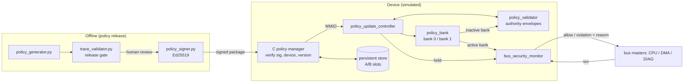
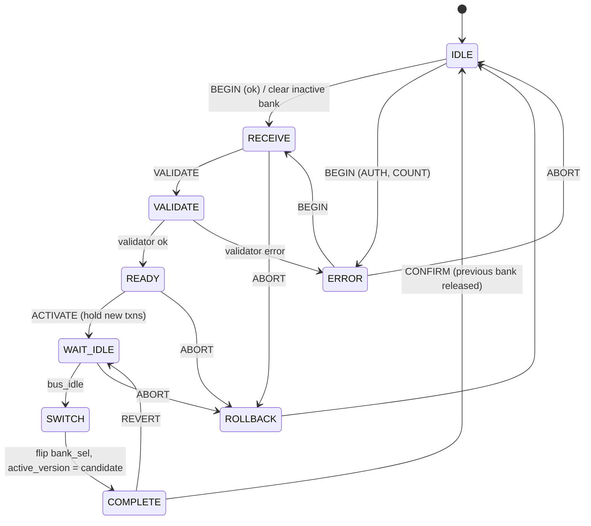

# Research and design

## 1. Problem and research question

Embedded SoCs stay in the field for years. Over that time new hardware weaknesses are found,
and an access pattern that was acceptable at manufacture can become an attack path. A bus
security monitor whose rules are frozen in silicon cannot follow. Making the rules updatable
creates a second problem: **whoever is allowed to update rules can also weaken them**, including
rules that protect *other* components.

> How can an embedded hardware security monitor adapt to newly discovered vulnerabilities
> through authenticated runtime policy updates, while ensuring that an authorised updater
> cannot weaken established security boundaries or unnecessarily disrupt legitimate transactions?

## 2. Sources studied

| Source | Status | What was read |
|---|---|---|
| L. Cunha et al., *Reconfiguring System-Level Protection Through Bounded Delegation in RISC-V MCUs*, arXiv:2611.12622 (v1, 9 Nov 2026) | **Preprint, not peer reviewed** | Abstract and roughly the first 40% of the HTML full text; the remainder only through an automated summary, so details from it are marked as such below |
| *Language Semantics to Support Secure Computation and Communication in Embedded Systems via Hardware Monitors* (D-GUARD), Integration, the VLSI Journal, 2025, doi:10.1016/j.vlsi.2025.102367 | Peer reviewed | **Full text not accessible** from this environment (publisher returned HTTP 403). Used only for motivation as described in the project brief; no technical claim below depends on it |
| *The Road Not Taken: eFPGA Accelerators Utilized for SoC Security Auditing* (EnSAFe), IEEE TCAD, 2024, doi:10.1109/TCAD.2024.3387350 | Peer reviewed | **Full text not accessible** (publisher blocked automated access). Used only for motivation, as above |
| NIST SP 800-193, *Platform Firmware Resiliency Guidelines* (2018) | Standard | Full PDF; sections 3.5 (update mechanisms) and 4.1 (roots of trust) read in detail |

Anyone citing D-GUARD or EnSAFe in a report should read them first; this repository does
not summarise their internals because they could not be read.

### 2.1 Bounded delegation (primary inspiration)

What the preprint argues (from the parts read):

- Commercial MCU protection units restrict **who** may write protection state, but not
  **what** an authorised writer may configure. An authorised owner of one rule can widen it
  into another domain's memory or add an overlapping rule that weakens someone else's protection.
- Each protection rule is an independently **owned** object. Only the owner may modify it, and
  a rule can only be created or widened inside a region the requester already controls
  (**containment**), so delegation is encoded by ownership plus range containment.
- An update controller sits between the configuration interface and the rule registers and
  checks a candidate **before** committing it (**validate-before-commit**); a rejected request
  leaves state unchanged. The normal access-checking path is not lengthened.
- Implementation (summary-derived): a CVA6-based RISC-V SoC on a Genesys2 FPGA, eight-slot
  "world checker", sequential validator scanning one slot per cycle. Reported overheads for
  eight rules are a few percent of LUTs over their baseline checker. Those numbers belong to
  that platform and are **not** comparable with the generic Yosys counts in this repository.

### 2.2 NIST SP 800-193 concepts used

- **Protection / detection / recovery** as the three resiliency principles.
- **Authenticated update mechanism** (3.5.1): updates carry digital signatures, verified by a
  Root of Trust for Update (RTU) holding the verification algorithm and a key store of public keys.
- The update path must stay operational or **recoverable after a power loss** mid-update (4.1.2).
- **Rollback**: implementations that authenticate updates may also check versions (3.5).
- **Recovery** to a known-good image kept separately from the corrupted one (3.5/4.4).

## 3. Contributions, gaps and what this project implements

| | Existing work (as far as it was read) | Gap / design opportunity for a small monitor | Implemented here |
|---|---|---|---|
| Bounded configuration authority | Ownership + containment for an MCU protection unit, validate-before-commit, per-request atomicity (preprint) | A transaction-level bus monitor with fixed per-owner envelopes, validated over a **whole multi-rule image** rather than one request at a time | Contribution A: `policy_validator.sv` checks every candidate rule against an immutable envelope table and checks ownership slot by slot against the active bank |
| Programmable monitor policies | Runtime-configurable hardware monitors (D-GUARD, EnSAFe per the brief) | A lightweight way to **decide offline** whether a candidate policy is good before anyone signs it | Contribution B: `tools/trace_validator.py` replays benign/malicious traces against old and new policies and acts as a release gate |
| Safe activation | Validate-then-commit of single requests; firmware must quiesce initiators (preprint) | Multi-rule updates where every intermediate state is never visible to the datapath | Contribution C: dual policy banks, validation of the inactive bank while the active one keeps enforcing, a one-bit switch at a transaction-idle boundary, revert until confirm |
| Firmware resiliency | NIST SP 800-193 principles | Apply them to *policy* data instead of firmware images | Ed25519 authenticated packages, anti-rollback version chain, A/B persistent store, boot-time re-authentication, fail-secure default deny |

**Engineering contribution claimed.** The implementation and measured evaluation of one
lightweight combination of three known ideas: (A) scope-bounded policy authority enforced in
hardware, (B) offline trace-based validation of candidate policies, and (C) atomic dual-bank
activation with recovery. The project does **not** claim to invent bounded delegation,
hardware monitors or dynamic policy updates, and it makes no claim of novelty beyond that
combination and its evaluation.

### Known differences from the referenced work

- Transaction-level monitor in front of a bus, not a processor-integrated protection unit; no
  RISC-V core, no hypervisor, no world/domain IDs from a CPU.
- One level of ownership with fixed envelopes; no nested or recursive delegation and no
  ownership transfer.
- A whole policy image is validated and switched at once, instead of one rule request at a time.
- Simulation and generic synthesis only: no FPGA, no eFPGA, no partial reconfiguration, no silicon.
- Signature verification lives in trusted firmware, not in hardware.

## 4. Architecture

| File | Role |
|---|---|
| `rtl/bus_security_monitor.sv` | Per-transaction check against the active bank; 1-cycle registered decision |
| `rtl/policy_bank.sv` | Two 8-slot banks, the bank-select bit, writes only to the inactive bank |
| `rtl/policy_validator.sv` | Multi-cycle bounded-authority validation of the inactive bank |
| `rtl/policy_update_controller.sv` | MMIO registers and update state machine |
| `rtl/security_monitor_top.sv` | Integration; `MODE` 0 static, 1 configurable-unbounded, 2 bounded dual-bank |
| `rtl/hsm_defs.svh` | Shared constants and the immutable authority table |

The same `bus_security_monitor` is used in all three modes, so the comparison isolates the
cost and the security effect of the policy back-end.

## 5. Policy model

### 5.1 Rule

Each slot holds an 80-bit rule: `valid, owner[3:0], start[31:0], end[31:0] (inclusive),
PRIV, W, R, max_burst[7:0]`. Transactions carry `master[3:0], addr[31:0], write, priv,
burst[7:0]` (beats of 4 bytes).

### 5.2 Immutable authority envelopes (synthetic SoC, design assumption)

| Owner (id) | Region | May read | May write | Max burst | Privilege floor |
|---|---|---|---|---|---|
| CPU (0) | 0x0000_0000 – 0x0000_FFFF | yes | yes | 16 | none |
| DMA (1) | 0x1000_0000 – 0x1000_FFFF | yes | yes | 64 | none |
| DIAG (2) | 0x2000_0000 – 0x2000_FFFF | yes | no | 4 | every rule must require privilege |

The table is a set of constant functions in `hsm_defs.svh`: there is no register, port or
command that can change it. Envelopes are disjoint, so the unassigned address space stays
default-deny for every possible validated policy.

### 5.3 Decision order (default deny)

1. master ID not a known owner → `BAD_MASTER`
2. no valid rule of that master contains the start address → `NO_RULE`
3. matched rule = **lowest slot index** among hits (validated policies never overlap, so this
   only matters for the unbounded baseline)
4. read without R → `READ_DENIED`; write without W → `WRITE_DENIED`
5. rule requires privilege, transaction unprivileged → `PRIV`
6. burst 0 or above the rule maximum → `BURST`
7. last byte `addr + 4*burst - 1` past the rule end, or wrapping past 2^32 → `SPAN`
8. otherwise `OK`

Outputs: `dec_valid`, `dec_allow`, `dec_violation`, `dec_reason[3:0]`, `dec_rule[2:0]`, `dec_rule_hit`.

## 6. Bounded-authority validation (Contribution A)

The controller latches the authenticated requester, candidate version and declared rule
count at `BEGIN`; they cannot change until the update finishes (no time-of-check/time-of-use gap).

| Order | Check | Error |
|---|---|---|
| at BEGIN | requester is CPU/DMA/DIAG, or ROOT while the boot window is open | `AUTH` |
| at BEGIN | 1 ≤ declared count ≤ 8 | `COUNT` |
| HDR | no malformed rule write (reserved ATTR bits, reserved field, unaligned) | `MALFORMED` |
| HDR | candidate version > active version | `VERSION` |
| per slot | **ownership**: if the active slot or the candidate slot holds another owner's rule, the candidate slot must be bit-identical to the active one | `FOREIGN` |
| per slot | owner ID is a known owner | `OWNER_ID` |
| per slot | max burst ≠ 0 | `MALFORMED` |
| per slot | start ≤ end | `RANGE` |
| per slot | **address containment**: envelope.lo ≤ start, end ≤ envelope.hi | `ADDR_ESCAPE` |
| per slot | **permission containment**: R/W only if the owner may | `PERM_ESC` |
| per slot | **privilege floor** respected | `PRIV_FLOOR` |
| per slot | **burst containment**: max burst ≤ envelope maximum | `BURST_ESC` |
| per pair | no two valid rules overlap (no ambiguity) | `OVERLAP` |
| FINAL | number of valid slots = declared count | `COUNT` |

The ownership rule covers all the prohibited cases at once: modifying, deleting or replacing
another owner's rule, and creating a rule in another owner's name. Because rule writes can only
reach the inactive bank and the candidate is a complete image, nothing an updater writes is
visible to the datapath until every check has passed.

**Schedule.** HDR (1 cycle), one slot per cycle (N), one overlap pair per cycle (N(N−1)/2),
FINAL (1). The controller sees completion one cycle later, so the measured time in `VALIDATE`
is N(N+1)/2 + 3 cycles: 6, 13, 24 and 39 cycles for 2, 4, 6 and 8 slots. The schedule does
not depend on the policy content (it only stops early on an error).

**Boot restore (ROOT).** After reset both banks are empty. The firmware restores the committed
image with requester ROOT, accepted only while the boot window is open. In this mode the
ownership comparison is skipped (there is nothing to protect yet), but **every envelope and
structural check still applies**. The first activation, or an explicit `LOCK`, closes the
window until the next reset.

## 7. Update controller and atomic activation (Contribution C)

The prompt's RECEIVE and WRITE_INACTIVE states are merged: the inactive bank *is* the staging
buffer, which saves a third copy of the rules.

- **Reset**: asynchronous, active low. State IDLE, bank 0 active, all valid bits cleared (rule
  payloads are not reset; an invalid slot never matches), versions 0, boot window open.
- **Register interface**: one write per cycle, combinational read. Rule writes are accepted only
  in RECEIVE and only reach the inactive bank. Commands not legal in the current state are ignored.
- **Safe boundary**: `ACTIVATE` moves to WAIT_IDLE, which deasserts `txn_ready` (no new
  transaction is accepted). The interconnect's `bus_idle` input reports that no granted burst is
  still in its data phase. When it is high the controller spends one cycle in SWITCH, and
  `bank_sel` flips at the end of that cycle. A transaction is therefore always checked entirely
  against one bank, and the switch cannot be starved by continuous traffic. Measured hold:
  2 cycles on an idle bus, and about 15 cycles on a busy one (waiting for outstanding bursts).
- **Revert and confirm**: after the switch the previous policy is still intact in the other
  bank. `REVERT` switches back at the next safe boundary and restores the previous version;
  `CONFIRM` releases it. The firmware confirms only after the new package is committed to
  persistent storage, so a store failure can be undone in hardware.
- **Failure**: a rejected or aborted candidate never touches the active bank, version or select bit.

### Register map (byte offsets)

| Offset | Name | Access | Content |
|---|---|---|---|
| 0x00 | CMD | W | 1 BEGIN, 2 VALIDATE, 3 ACTIVATE, 4 CONFIRM, 5 REVERT, 6 ABORT, 7 LOCK |
| 0x04 | STATUS | R | [3:0] state, [4] busy, [5] active bank, [6] boot window, [7] revert available, [15:8] error, [18:16] error slot |
| 0x08 | REQ_OWNER | RW* | authenticated requester |
| 0x0C | CAND_VERSION | RW* | candidate policy version |
| 0x10 | RULE_COUNT | RW* | declared number of rules |
| 0x14 | ACTIVE_VERSION | R | version currently enforced |
| 0x18 | PREV_VERSION | R | version retained for revert |
| 0x1C | HW_INFO | R | 0x48, mode, owners, rule slots |
| 0x40 + 16·s | RULE[s].START / END / ATTR | W (RECEIVE only) | ATTR: [31] valid, [19:16] owner, [10] PRIV, [9] W, [8] R, [7:0] max burst; other bits must be 0 |

\* writable only in IDLE or ERROR.

## 8. Policy package and authentication

Little-endian, fixed width. Size = 120 + 12 × rules bytes (144 to 216 bytes).

| Offset | Size | Field |
|---|---|---|
| 0 | 4 | magic `HSMP` |
| 4 | 2 | format version (1) |
| 6 | 2 | header size (120) |
| 8 | 4 | device ID |
| 12 | 1 | requesting owner (0 CPU, 1 DMA, 2 DIAG, 0x0F provisioning ROOT) |
| 13 | 1 | rule count (1..8) |
| 14 | 2 | payload length (= 12 × count) |
| 16 | 4 | policy version |
| 20 | 4 | previous policy version |
| 24 | 32 | BLAKE2b-256 digest of the payload |
| 56 | 64 | Ed25519 signature over bytes 0–55 |
| 120 | 12 × n | rules: start u32, end u32, slot u8, owner u8, flags u8 (R, W, PRIV), max burst u8 |

**Split of responsibilities.** The C policy manager (`firmware/src/policy_pkg.c`,
`policy_manager.c`) verifies length fields before touching anything else, picks the public key
from the **device configuration** using the requester field (never from the package), verifies
the Ed25519 signature (Monocypher 4.0.2), checks the digest in constant time, then the device
ID, then encoding rules (reserved flag bits, slot range, duplicate slots, owner values that
would alias in the 4-bit hardware field). It enforces the version chain
(`version > committed`, `prev_version == committed`) and keeps ROOT packages off the runtime
path. It does **not** decide what the rules may contain. That decision belongs to the hardware
validator, which checks independently and does not trust the firmware's view of authority.

Private test keys are generated into `build/keys/` (git-ignored); only the public key table is
compiled into the firmware (`build/gen/device_config.c`).

## 9. Update workflow

| Step | Where | Implementation |
|---|---|---|
| 1–2 generate policy, choose requester | offline | `policy_generator.py`, `examples/*.json` |
| 5–8 traces, replay, report, gate | offline | `trace_validator.py gen / compare` (exit 1 = not recommended) |
| 3–4 package and sign | offline, after human review | `policy_signer.py sign` |
| 9–12 receive, signature, owner/device, version | firmware | `pm_install` → `pkg_parse_verify` |
| 13 load the inactive bank | firmware → RTL | `BEGIN` + rule writes |
| 14–15 hardware containment check | RTL | `VALIDATE` → READY or ERROR |
| 16–17 wait for idle, atomic switch | RTL | `ACTIVATE` → WAIT_IDLE → SWITCH |
| 18 report active version | RTL | `ACTIVE_VERSION`, `STATUS` |
| 19 keep previous policy | RTL + store | other bank until `CONFIRM`; previous package kept in the other store slot |

Trace validation (offline, before signing) and hardware authority validation (on the device,
at update time) are separate and independent: the first judges whether a policy is *good*,
the second whether the requester was *allowed* to ask for it.

## 10. Persistence and recovery

`firmware/src/pstore.c` simulates flash with two package slots and two metadata copies
(magic, sequence number, slot, version, length, CRC-32). An install writes the new package into
the slot that is **not** committed, activates it in hardware, then overwrites the older
metadata copy. Booting takes the valid metadata copy with the highest sequence number,
re-verifies the stored package's signature, and restores it through the boot window. A power
loss at any byte leaves the previous committed policy intact; an image that fails
re-authentication leaves the monitor in default-deny with the boot window locked (fail-secure).

## 11. Verification approach

- **Reference models** in `tools/hsm_common.py` mirror the monitor and the validator.
- **Equivalence on traces**: the RTL replays the 477-transaction corpus under v1–v4 in all
  modes and must match the Python decision and reason for every transaction.
- **Firmware/RTL cross-check**: the C host backend records every register access;
  `tb_mmio_replay.sv` replays the whole C test suite (≈17 700 operations, including 428
  resets from power-loss tests) into the RTL and compares every read-back.
- **Directed RTL tests** for every listed case (see `tb/`).
- **Mutation check** (`scripts/mutation_check.py`): 20 deliberately planted security bugs, each
  of which must make the regression fail. Its first run found an untested corner: an overlap
  in the last slot pair. A test for it was added.

No formal verification was performed.

## 12. Design iteration recorded

The first validator selected slots with one-hot AND-OR logic. Rewriting the three read ports as
indexed part-selects let Yosys build mux trees: 5 682 → 4 860 generic cells for the validator
(−14%). Priority-encoding the matched index first and then indexing reduced the monitor from
3 900 to 3 502 cells (−10%). Both versions pass the full regression and mutation check.
These are generic-gate counts; the timing effect was not evaluated.
